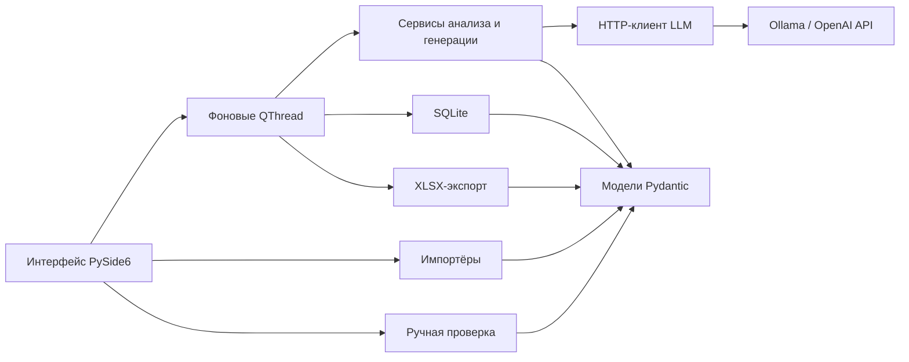

# Архитектура и алгоритмы

## Слои

| Слой | Ответственность |
| --- | --- |
| ui | Представление, выбор файлов, формы, сигналы QThread, навигация |
| models | Pydantic: требования, элементы, тесты, покрытие, журнал, исходная статистика |
| importers | Чтение документов/таблиц, сопоставление колонок, проверка записей |
| llm | HTTP Ollama/OpenAI, таймауты, TLS-проверка, безопасные ошибки |
| services | Выделение, гибридное покрытие, генерация, редактирование, принятие |
| storage | SQLite-снимок, проверка версии/данных, атомарная запись |
| exporters | Шестилистовый XLSX, статистика и доказательства |
| tests | Проверки моделей, UI, HTTP-протоколов и полного процесса |

## Модели и инварианты

ID уникальны внутри каждого набора. Ссылки на требования/элементы/тесты должны
существовать и относиться к одному требованию. Цитата элемента — непрерывный
фрагмент исходного текста. Неизвестные поля запрещены. Уверенность — конечное
число 0…1. API-ключ — SecretStr с исключением из сериализации настроек;
настройки вообще не входят в Project.

Сервисы создают новый снимок через Project.model_validate. Изменение списка
модели на месте не запускает валидацию Pydantic, поэтому используется только
в контролируемых тестовых фикстурах, а не для изменения проекта в сервисах.

## Выделение

Актуальная архитектура 0.2.0: [extraction_v2.md](extraction_v2.md). Выделение и
экспертиза выполняются разными запросами, условия задаются ссылками модели.
Правила распознавания фраз и достройки элементов удалены. `analysis_blocked`
исключает спорный элемент до ручного решения; `analysis_incomplete` отражает
неподтверждённую полноту. Описание ниже относится к предыдущей версии.

Программа строит каталог предложений/абзацев исходного требования с локальными
ID и точными координатами. Модель возвращает категории, описания и source_ids,
не перепечатывает цитаты. Приложение проверяет ссылки и создаёт source_refs
из оригинала; широкий источник может поддерживать несколько элементов.
Неизвестные ID и нарушения структуры/известные противоречия допускают до трёх
попыток исправления; проект изменяется только после завершения всего анализа.
Проверка источника не доказывает истинность описания: ручная проверка обязательна.
Формат, совместимость и ограничения описаны в [source_references.md](source_references.md).

## Покрытие

Пары формируются для одного требования. Детерминированно сопоставляются
технические токены и поддерживаемые противоречия; совпадение не является
доказательством. LLM получает исходный текст, связанные аспекты и сценарий,
возвращает статус, обоснование, уверенность и точные цитаты действий/результата.
Выдуманные цитаты отвергаются; недостаточные доказательства, отсутствующие
токены, низкая уверенность и известные противоречия требуют проверки.

Положительная связь считается подтверждённой только после принятия пользователем.
Статус и обоснование пользователя хранятся отдельно от ответа модели.
Повторный анализ не переносит прежние подтверждения на новые решения.

## Генерация

Цели — все элементы при отсутствии тестов либо аспекты без принятой положительной
связи. Запрос включает весь контекст требования, имеющиеся сценарии и покрытые
аспекты. ID назначаются приложением. Проверяются структура/ссылки, известные
противоречия, ошибки сценария CRC и нормализованные точные дубликаты. Другим
запросом оцениваются согласованность, достаточность спецификации и семантические
дубликаты. Проверка той же моделью статистически не независима.

Операция атомарна на уровне проекта: структурная ошибка/ошибка сервера/отмена
не применяет частичный набор. Обычное отклонение отдельного кандидата записывается
в журнал и не мешает оценке остальных. Принятие теста не создаёт покрытие.

## Хранение и отчёт

Один SQLite-файл содержит один валидированный JSON-снимок проекта в таблице
project_snapshot; application_id и user_version идентифицируют формат.
Чтение — только для чтения, с полной проверкой перед заменой UI-состояния.
Запись — в соседний временный SQLite-файл, commit, закрытие соединения,
проверка чтения и os.replace. Неизвестная/повреждённая база не перезаписывается.
Это снимок состояния, а не полноценная история всех редакций проекта.

XLSX также записывается через временный файл. Текст не превращается в формулы;
слишком длинные ячейки отвергаются вместо обрезания. В отчёте сохраняются
решения/доказательства и исходный снимок покрытия, если он действительно известен.
